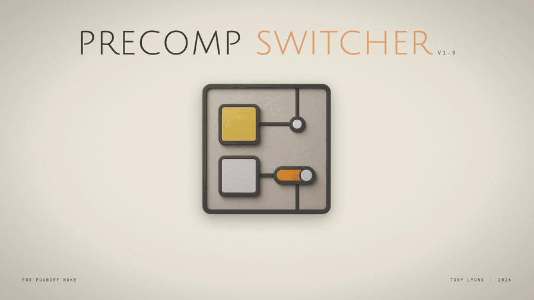
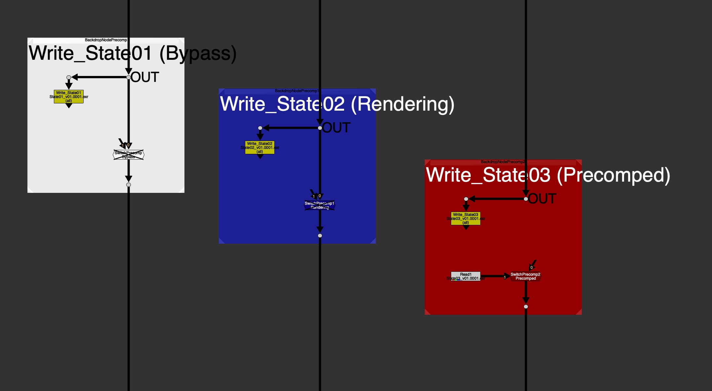
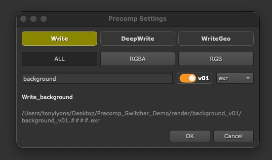
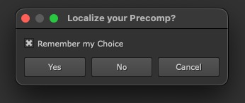

by [Tony Lyons](https://github.com/CreativeLyons) |  www.compositingmentor.com
# Precomp Switcher

The Precomp Switcher lets you define important settings of your Write node quickly and intuitively, and creates a **Write + Switch + Backdrop** setup.

There are clear labels and colors, always letting you know the current **"State"** of the precomp.

Toggle between **Precomped** and **Bypass** states, simply by disabling the switch node.  The **Rendering** state reminds you to swap out your precomp when it's done rendering.

Stop manually reconnecting. Start Switching.

## Why use it?

- **Consistency.**  Every precomp in every script looks and behaves the same.
- **Readability.**  Tile color and label tell you at a glance whether a precomp is live, mid-render, or rendered.
- **Speed.**  One hotkey to build, one to render, one to read back and flip/toggle.
- **Pipeline-friendly.**  If your studio has its own render command, custom Write Node, custom Read Node or read-from-write tool, a TD can configure this tool to use those hooks to their own pipeline commands, instead of native Nuke ones.

## The 3 states at a glance



Every precomp sits in one of three states.  The Backdrop and Switch tile & colors all track the state together:

| State         | Color | What it means                                         |
|---------------|-------|-------------------------------------------------------|
| **Bypass**    | White | Live. Switch disabled; downstream sees the live tree. |
| **Rendering** | Blue  | The Write is being rendered. Visual-only marker.      |
| **Precomped** | Red   | Reading the rendered output by the enabled Switch.    |

## Quick Start



1. Start with a saved `.nk` script.
2. Head to the area of the comp tree you want to precomp and press **Shift+W**.
3. Type a precomp name, click **OK**.
4. You should see a new Precomp Switcher backdrop with a Write + Switch.
5. With the precomp Write selected, press **F7** to render. Your Precomp Switcher should turn Blue and say **Rendering**.
6. When the render is done, select only the precomp Write and press **Alt+R** to create and connect a Read.
7. The Precomp Switcher should turn Red and say **Precomped**.
8. Disable/enable the SwitchPrecomp at any time to toggle between Precomped and Bypass.  Pressing **Alt+R** with either the Read or the Switch selected will also toggle the Bypass/Precomped states.

For the full walkthrough, see User Guide §4.

## Node Graph Hotkeys

| Key         | Action                                                       |
|-------------|--------------------------------------------------------------|
| **Shift+W** | Create Precomp Switcher.                                     |
| **F7**      | Render selected Writes; each backdrop flips to **Rendering**. |
| **Alt+R**   | Read from Write, or toggle between **Bypass** and **Precomped**. |

Defaults can be overridden in [`precomp_config.py`](precomp_switcher/precomp_config.py).  See User Guide §7 for the full hotkey behavior, including the optional Linked Read variant.

## Localization (Optional Feature)



If you're working with files over a network, there's an optional feature for Localizing your Precomp Reads automatically.  If enabled, there will be a prompt on your first Read from Write, where it will ask if you'd like to Localize your precomp.  Click **Remember my Choice** to always repeat for later Read from Write actions.  The choice is stored in the Write node under a Precomp Tab, so that you can always change later.

This feature is disabled by default.

Set `PRECOMP_LOCALIZATION_FEATURES_ENABLED = True` in the `precomp_config.py` to enable.

## Installation

**Requirements:** Nuke 13+.

Precomp Switcher is a self-loading plugin.  Meaning it's designed to load everything it needs by just adding the folder to Nuke's plugin path.

Here is a step by step guide:

1. Simply download the latest Release `.zip`, or clone/download this repo anywhere on disk.
2. Add the `precomp_switcher` folder (the one with all the .py files) to your Nuke plugin path.

   **Option A**
   - Drop the folder inside your `~/.nuke/` directory
   - Open or create your `~/.nuke/init.py` file in a Text Editor
   - Then add this line to your `init.py`:
     ```python
     nuke.pluginAddPath('./precomp_switcher')
     ```
   **Option B**
   - Or use any other location on disk or over the network:
     ```python
     nuke.pluginAddPath('/path/to/precomp_switcher')
     ```
   - Above is just an example path, so be sure to replace `/path/to/` with the folder path where you placed the precomp_switcher.

That's it! No `menu.py` entry needed.  
If you want to remove, add, or change hotkeys of Precomp Switcher, open up the `precomp_config.py` in a Text Editor and there you can assign, change, or disable hotkeys.

See **Developer Guide §2** for more info on customization via the config file.

After Nuke launches, you should see **Edit → Node → Precomp Switcher → Create Precomp Switcher** with **Shift+W** as its hotkey.

## Documentation

- **User Guide (PDF)**: install, quick start, every feature, troubleshooting.
- **Developer Guide (PDF)**: pipeline integration, configuration reference, architecture.
- [**`precomp_config.py`**](precomp_switcher/precomp_config.py): every user setting in one file with inline comments for help.

## License & Credits

MIT License.  © 2026 [Tony Lyons](https://github.com/CreativeLyons).  See [LICENSE](LICENSE).

www.CompositingMentor.com
Contact: [creativelyons@gmail.com](mailto:creativelyons@gmail.com)

### Special Thanks

A very special thanks to **Alexey Kuchinski** for inspiring the idea, design, and functionality of the Precomp Switcher from his own tool.  Full credit for the inception of the idea goes to Alexey.  This is my best implementation of that idea, brought to the community.

The User and Dev guides were inspired by three well-loved Nuke tool user guides: **KnobScripter v3.2** (Adrian Pueyo), **Stamps v1.1** (Adrian Pueyo & Alexey Kuchinski), and **W_hotbox v2.0** (Wouter Gilsing).  Thanks for showing me how it's done!
